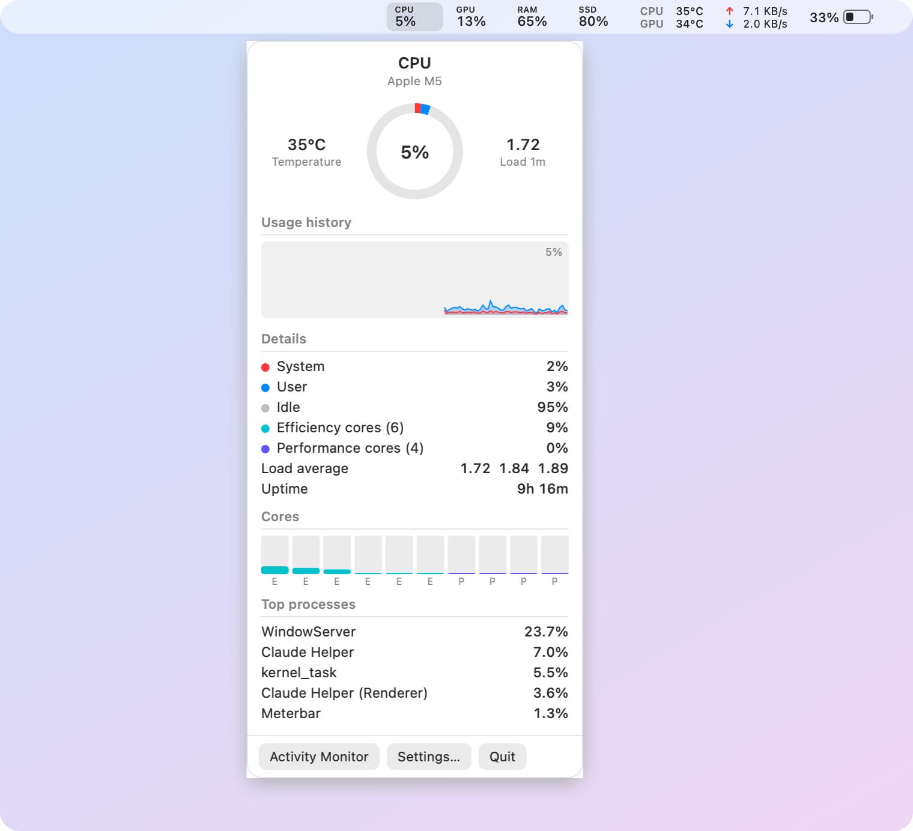
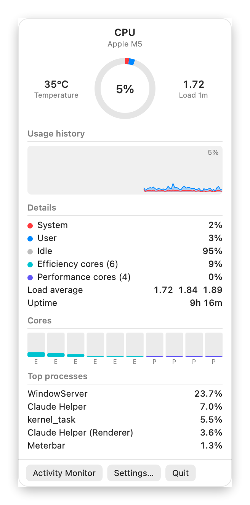
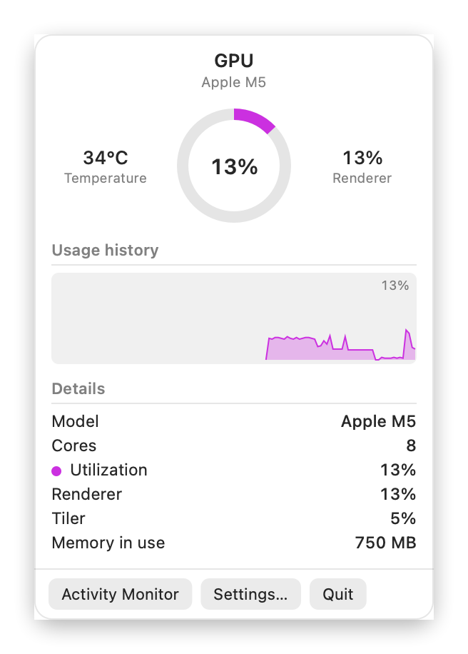
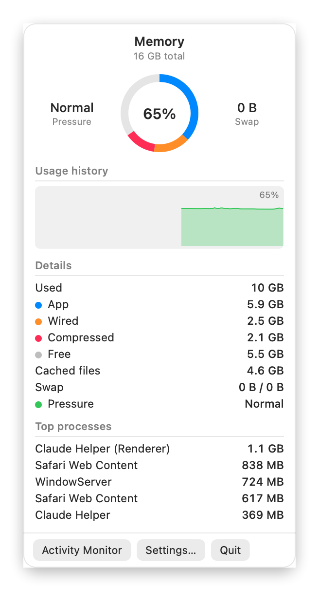
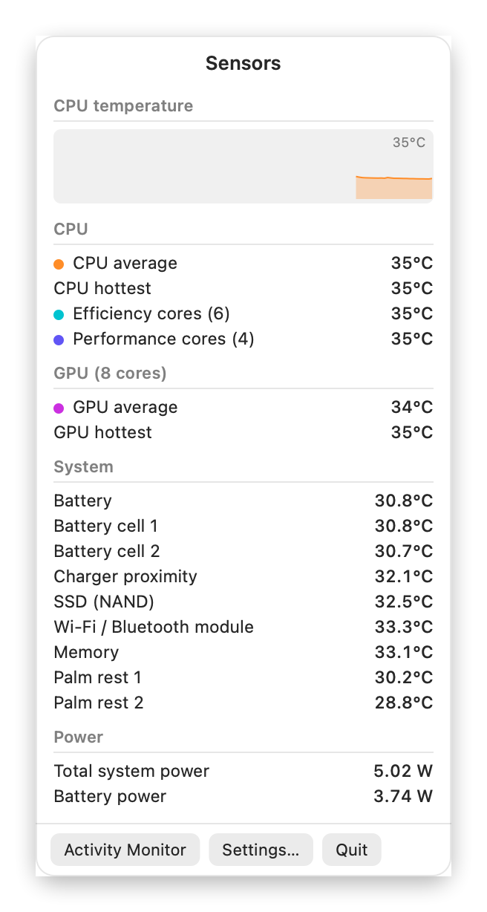
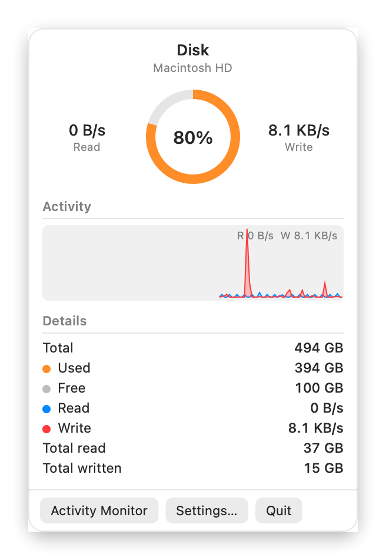
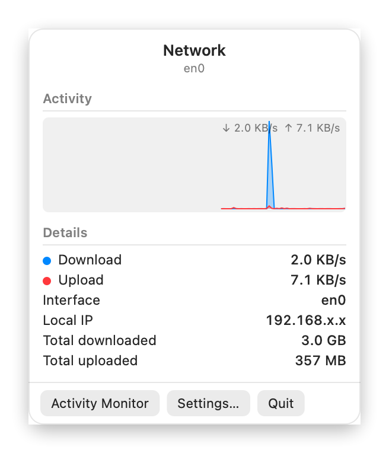
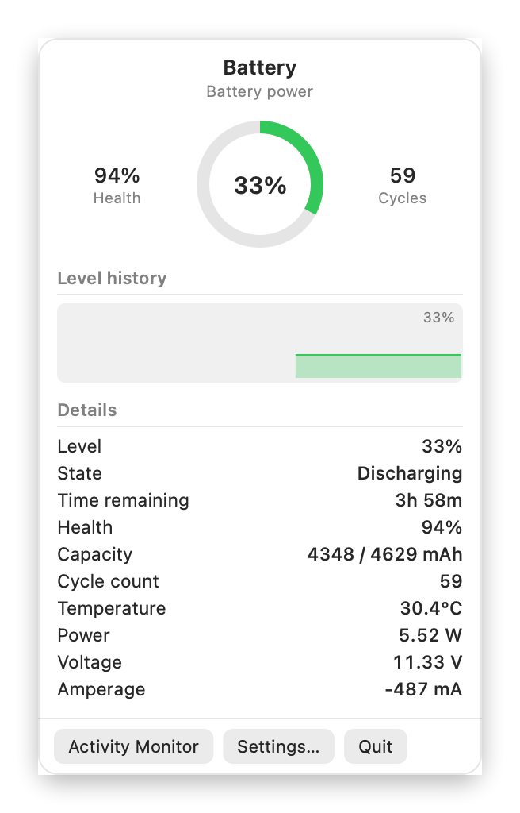
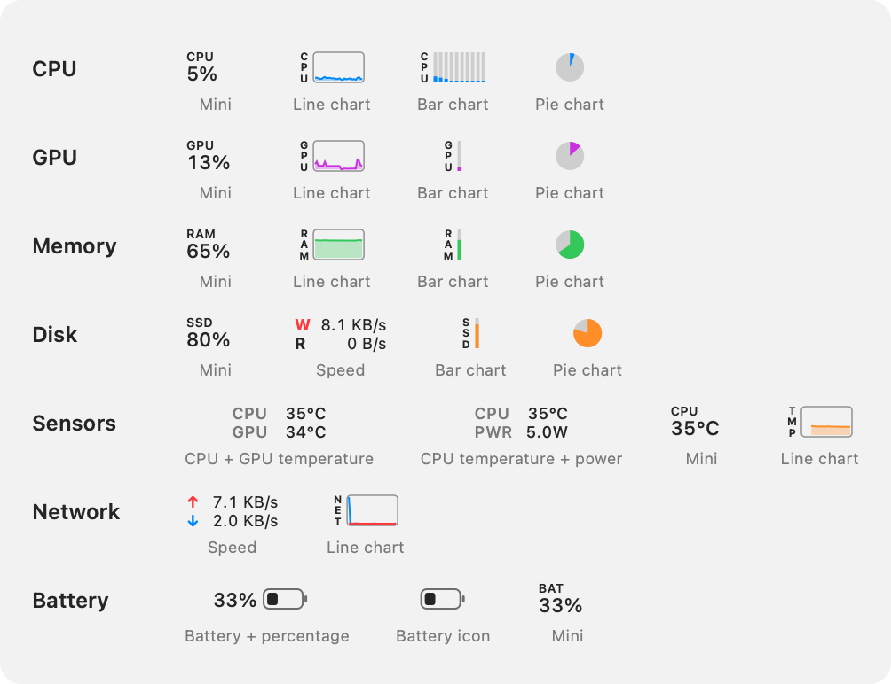

<div align="center">

# Meterbar

**A tiny, native macOS menu bar system monitor.**<br>
CPU, GPU, memory, disk, network, temperatures and battery, in about 12 MB of RAM.

[](https://github.com/ShivamHimatsingka/Meterbar/releases/latest)


[](LICENSE)

<picture>
  <source media="(prefers-color-scheme: dark)" srcset="docs/images/hero-dark.png">
  
</picture>

</div>

## Highlights

- **Light on resources.** About 12 MB of RAM and 0.3% CPU at idle, roughly a tenth of what similar apps use. See [Resource use](#resource-use).
- **Everything at a glance.** Seven modules, each with its own menu bar widget and a detailed popup with live charts.
- **Accurate.** Readings match Stats and Activity Monitor, and the top-processes lists include system processes such as WindowServer and kernel_task.
- **Real temperatures.** Reads CPU, GPU, memory, SSD, battery and other sensors directly from the SMC, with readable names.
- **Native and simple.** One Swift file, built on AppKit and Core Graphics, with no dependencies, no network access and no telemetry.

## Download

1. Download **Meterbar.zip** from the [latest release](https://github.com/ShivamHimatsingka/Meterbar/releases/latest).
2. Unzip it and move **Meterbar.app** to your Applications folder.
3. Open it. The meters appear in your menu bar; click any one for details.

> [!NOTE]
> Meterbar is open source but not notarized by Apple (that requires a paid developer account), so the first time you open it macOS will say it can't verify the developer. To allow it, go to **System Settings → Privacy & Security** and click **Open Anyway**, or run:
> ```bash
> xattr -dr com.apple.quarantine /Applications/Meterbar.app
> ```

Requirements: macOS 13 Ventura or later, on Apple Silicon or Intel. To start Meterbar automatically, turn on **Launch at login** in Settings.

## Popups

Click any meter in the menu bar to open its popup. Popups update live and close when you click anywhere else.

<table>
  <tr>
    <td align="center"><b>CPU</b></td>
    <td align="center"><b>GPU</b></td>
    <td align="center"><b>Memory</b></td>
  </tr>
  <tr>
    <td valign="top"><picture><source media="(prefers-color-scheme: dark)" srcset="docs/images/popup-cpu-dark.png"></picture></td>
    <td valign="top"><picture><source media="(prefers-color-scheme: dark)" srcset="docs/images/popup-gpu-dark.png"></picture></td>
    <td valign="top"><picture><source media="(prefers-color-scheme: dark)" srcset="docs/images/popup-ram-dark.png"></picture></td>
  </tr>
  <tr>
    <td align="center"><b>Sensors</b></td>
    <td align="center"><b>Disk</b></td>
    <td align="center"><b>Network</b></td>
  </tr>
  <tr>
    <td valign="top"><picture><source media="(prefers-color-scheme: dark)" srcset="docs/images/popup-sensors-dark.png"></picture></td>
    <td valign="top"><picture><source media="(prefers-color-scheme: dark)" srcset="docs/images/popup-disk-dark.png"></picture></td>
    <td valign="top"><picture><source media="(prefers-color-scheme: dark)" srcset="docs/images/popup-net-dark.png"></picture></td>
  </tr>
  <tr>
    <td align="center"><b>Battery</b></td>
    <td></td>
    <td></td>
  </tr>
  <tr>
    <td valign="top"><picture><source media="(prefers-color-scheme: dark)" srcset="docs/images/popup-battery-dark.png"></picture></td>
    <td></td>
    <td></td>
  </tr>
</table>

| Module | What the popup shows |
|---|---|
| **CPU** | Usage donut with temperature and load, system/user history, efficiency vs performance core usage, per-core bars, load average, uptime, top processes |
| **GPU** | Utilization, renderer and tiler use, memory in use, temperature, history |
| **Memory** | App, wired, compressed and free memory, cached files, swap, memory pressure, history, top processes |
| **Sensors** | CPU and GPU average and hottest temperatures, efficiency and performance clusters, memory, SSD, battery, Wi‑Fi, palm rest, fans, system and battery power |
| **Disk** | Used and free space, read/write speed history, totals since boot |
| **Network** | Download/upload history, interface, local IP, totals since boot |
| **Battery** | Level, health, cycle count, temperature, voltage, current, power draw, charger wattage, time remaining |

## Menu bar widgets

Each module has several widget styles. Pick one per module in **Settings**, and ⌘-drag widgets to reorder them.

<picture>
  <source media="(prefers-color-scheme: dark)" srcset="docs/images/menubar-dark.png">
  
</picture>

<picture>
  <source media="(prefers-color-scheme: dark)" srcset="docs/images/widgets-dark.png">
  
</picture>

## Resource use

Measured on a MacBook Air (Apple M5, macOS 26) over two minutes at idle. Meterbar and Stats each ran alone with the same four modules (CPU, GPU, Memory, Sensors) updating every second; Activity Monitor was measured with its window open:

| | **Meterbar** | Stats | Activity Monitor |
|---|---:|---:|---:|
| CPU | **0.3%** | 2.5% | 7.9% + 2.3% (`sysmond`) |
| Memory | **12 MB** | 138 MB | 123 MB |
| Threads | **4** | 12 | 13 |
| App size | **0.4 MB** | 19 MB | built in |

With a popup open, Meterbar uses about 20–31 MB. While the CPU or Memory popup is open, the `top` helper that lists processes adds about 3% of one core.

<details>
<summary><b>How it stays light</b></summary>

- **Drawing:** widgets are drawn directly with Core Graphics, with no SwiftUI or web views, and only redrawn when the displayed value changes.
- **Hidden items:** items macOS hides behind the notch aren't drawn at all.
- **Popups:** created when opened and released when closed. They're painted on the CPU into a bitmap. Ordinary view drawing that updates every second makes macOS 26 move the window onto GPU rendering, which costs about 31 MB more.
- **Sensors:** read every 2 s, from a small subset of SMC keys unless the Sensors popup is open.
- **Slow-changing values:** battery and disk space are polled less often.
- **Sleep and lock:** sampling pauses while the display is asleep or the screen is locked.

</details>

## Accuracy

Meterbar uses the same system data sources as Activity Monitor and Stats. In a side-by-side test under steady load:
- **CPU, GPU and memory:** within 1% of Stats.
- **Memory breakdown:** matches Activity Monitor (wired, compressed and "Memory Used").
- **Battery:** matches `pmset`.
- **Per-process numbers:** match `top`.

<details>
<summary><b>Where each reading comes from</b></summary>

| Reading | Source |
|---|---|
| CPU usage | `host_processor_info`; efficiency and performance cores identified from the IORegistry device tree |
| GPU usage | `IOAccelerator` → `PerformanceStatistics` |
| Memory | `host_statistics64`, counted the way Activity Monitor does ("Memory Used" = app + wired + compressed) |
| Disk | `IOBlockStorageDriver` statistics, plus volume capacity |
| Network | 64-bit interface counters (`NET_RT_IFLIST2`) |
| Temperatures, fans, power | SMC keys, discovered at launch: `Te*` efficiency cluster, `Tp*` performance cluster and `Tg*` GPU sensors, plus memory, SSD, battery, Wi‑Fi, palm rest, `PSTR`/`PPBR` power and fans |
| Battery | IOPowerSources and `AppleSmartBattery` |
| Top processes | `/usr/bin/top`, run only while the CPU or Memory popup is open |

Apple chips have several thermal sensors spread across each group of cores, so the full sensor list shows more sensors than there are cores.

macOS doesn't let ordinary apps read CPU usage of system processes. `top` is allowed to because it runs as root (setuid), so Meterbar reads the process list from it, as Stats does.

</details>

## Build from source

You need Xcode or the Command Line Tools.

```bash
git clone https://github.com/ShivamHimatsingka/Meterbar.git
cd Meterbar
./build.sh
open Meterbar.app
```

`build.sh` compiles `main.swift` into a universal (arm64 + x86_64) app for macOS 13 or later, then ad-hoc signs it.

<details>
<summary><b>Developer flags</b></summary>

| Flag | What it does |
|---|---|
| `--dump` | Prints every reading once, then exits |
| `--screenshots <dir> [seconds]` | Samples for the given number of seconds (default 45), then renders the README images (popups, widgets, menu bar and hero) in light and dark mode |
| `--open <cpu\|gpu\|ram\|disk\|sensors\|net\|battery>` | Opens that popup on launch |

</details>

## Tips and limitations

- **Notch:** on MacBooks with a notch, macOS hides menu bar items that don't fit beside it. If a meter goes missing, turn off modules you don't need, or hide unused system items in System Settings → Menu Bar. Meterbar also supports the NotchOverflow app, which can show hidden items.
- **Not included:** fan *control* (it needs a privileged helper), CPU frequency, public IP and Wi‑Fi network name.
- **Intel Macs:** supported, but sensors were developed and tested on Apple Silicon.

## Acknowledgements

Meterbar's layout is inspired by [Stats](https://github.com/exelban/stats) by [@exelban](https://github.com/exelban). Meterbar is an independent project with its own code, and is not affiliated with Stats.

## License

[MIT](LICENSE) © 2026 Shivam Himatsingka
